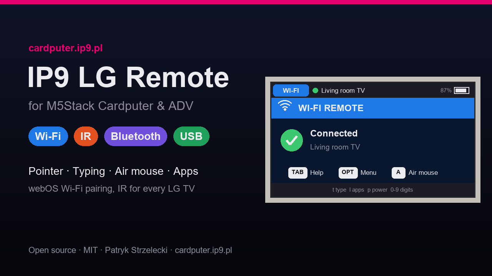
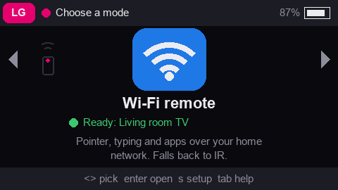
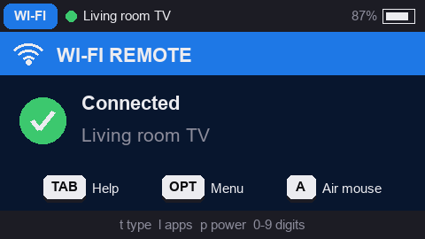
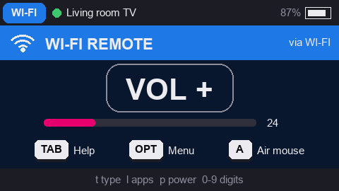
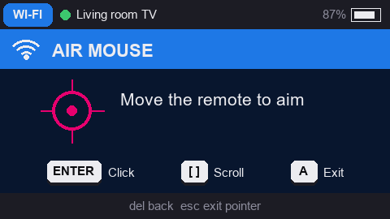
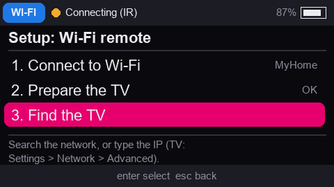
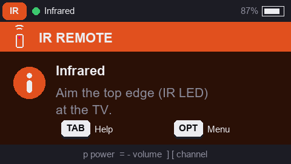
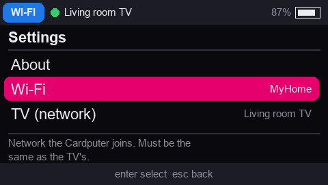

# IP9 LG Remote



A "Magic Remote" for LG webOS TVs running on the **M5Stack Cardputer** and **Cardputer ADV**.
One of the IP9 apps for the Cardputer – **https://cardputer.ip9.pl**.

- **Wi-Fi remote (webOS API)** – pointer (cursor), typing on the TV, app launcher, volume level,
  with **LG IP Control** as a TLS-free fallback and infrared for keys the network cannot send.
- **IR remote** – works with every LG TV out of the box, also while the TV is off.
- **Bluetooth (beta)** – keyboard + mouse + media keys for TVs with webOS 5 (2020) or newer.
- **USB cable** – the same as a USB keyboard + mouse; works with older TVs too.
- **Air mouse** – on the Cardputer ADV the BMI270 gyroscope moves the cursor like a Magic Remote;
  on both models the arrow keys can move it too.

Author: Patryk Strzelecki <patryk@strzelecki.info> · License: MIT · https://github.com/raptyk/IP9LGRemote

## Screens

| | |
|---|---|
|  |  |
| **Home** – one card per mode, setup state at a glance | **Wi-Fi remote** – mode band, connection badge, key hints |
|  |  |
| **Feedback** – last command, link used, TV volume | **Air mouse** – gyroscope pointer on the Cardputer ADV |
|  |  |
| **Setup** – guided first run, later steps locked | **IR remote** – works with every LG TV |
|  | |
| **Settings** – every option explains itself | |

Screens are rendered at 2× from the firmware layout (`python tools/make_screenshots.py`);
on the device the fonts are the M5GFX bitmap fonts.

## Install with M5Launcher

1. Download (or build) `release/IP9LGRemote-<version>.bin`.
2. Copy it to the SD card (FAT32).
3. In M5Launcher: **SD → select the file → Install**.

The `-full.bin` image (bootloader + partitions + app) can be flashed without Launcher:

```bash
esptool.py --chip esp32s3 write_flash 0x0 release/IP9LGRemote-1.6.0-full.bin
```

## First steps

The firmware starts on a **home screen** with one card per mode (`,` `/` to choose, `enter` to open).
A mode that is not configured yet opens its **setup checklist** first; every step explains itself
at the bottom of the screen and the remote starts only when all steps are done.

- **Wi-Fi remote**: join Wi-Fi → prepare the TV (LG Connect Apps / Mobile TV On) → find the TV
  (search or IP address) → pair (press *Allow* on the TV, or press `p` for PIN pairing).
- **IR remote**: no setup – ready right away (`s` on the card runs an optional IR test).
- **Bluetooth**: needs webOS 5+; the pairing screen shows where the TV menu is.
- **USB cable**: plug a USB-C cable into the TV; the setup completes when the TV detects it.

Settings are also copied to the SD card (`/config/lgtv-remote/settings.json`), so a
re-install keeps the Wi-Fi and the TV pairing; Settings > SD card backup can save, restore or
delete that copy. The file contains the Wi-Fi password and the TV pairing key.

Optional, webOS 23+: *Settings > Support > IP Control Settings* shows an 8-character keycode –
enter it in **Settings > TV (network) > IP Control keycode** for an extra fallback link.
(The 6-character code of the *Developer Mode* app is unrelated and not needed.)

The RGB LED shows the mode colour: a flash for every sent command, a slow pulse while
connecting, green / red blinks for connected / errors (Settings > Status light turns it off).

## Keys (remote screen)

Arrows work with or without `fn` (the Cardputer convention `fn` + `;` `.` `,` `/`).

| Key | Action | Key | Action |
|---|---|---|---|
| `;` `.` `,` `/` | arrows | `enter` | OK |
| `del` | Back | `esc` | Exit |
| `h` | Home | `s` | Settings |
| `q` | Quick menu | `i` | Input |
| `o` | Info | `e` | Guide |
| `p` | Power | `=` `-` | Volume |
| `m` | Mute | `]` `[` | Channel |
| `0`–`9` | digits | `space` | Play / Pause |
| `z` `x` `c` | Rewind / Stop / Forward | `r` `g` `y` `b` | colour keys |
| `a` / `G0` | pointer on/off | `[` `]` | scroll (pointer mode) |
| `t` | type on TV | `l` | apps |
| `opt` / `fn`+`esc` | back to the app menu | `tab` | help |

Design rationale: [docs/UX_DESIGN.md](docs/UX_DESIGN.md). Protocol research: [docs/PROTOCOLS.md](docs/PROTOCOLS.md).

## Build

Requires [PlatformIO](https://platformio.org/). The shared IP9 core,
[IP9Kit](https://github.com/raptyk/IP9Kit) (app shell, menus, home carousel, help, dialogs,
keyboard, status LED, battery), is fetched by PlatformIO at the version pinned in `platformio.ini`.

```bash
pio run
```

To change IP9Kit together with the remote, clone it next to this folder (`../IP9Kit`) and copy
`ip9kit-local.ini.example` to `ip9kit-local.ini`.

The post-build script writes both images to `release/`. `python tools/check_text_fit.py` checks
that every UI string fits the 240×135 screen using the real font metrics.

The firmware runs USB in TinyUSB (OTG) mode for the USB cable mode, so there is no serial console;
to flash over USB directly (`pio run -t upload`), hold `G0` while plugging the cable in.

### Project layout

```
src/
  app/        App (main loop, screen stack), Settings (NVS), menus
  core/       RemoteKey, Transport interface, CommandRouter (link selection + fallback)
  ir/         NEC transport and LG code table
  webos/      SSAP client (own FreeRTOS task), manifest, key map, SSDP discovery, Wake-on-LAN
  ipcontrol/  LG IP Control client (AES / PBKDF2)
  ble/        BLE HID composite device (NimBLE)
  usb/        USB HID composite device (TinyUSB)
  hw/         air mouse (device, keyboard and status LED come from IP9Kit)
  ui/         theme, strings, icons, mode styles, screens (on the IP9Kit screen classes)
tools/        development helpers (text fit check)
```

## Limitations

- The original Magic Remote Bluetooth protocol is not emulated (the TV-side pairing is undocumented,
  see docs/PROTOCOLS.md). The pointer works over the network, as a Bluetooth mouse or over USB instead.
- Bluetooth keyboards/mice need webOS 5 (2020) or newer; webOS 4.5 accepts only the LG Rolly keyboard.
  Use **Settings > Bluetooth > Key test** to check which keys your TV understands.
- No IR receiver on the Cardputer: codes cannot be learned from another remote.
